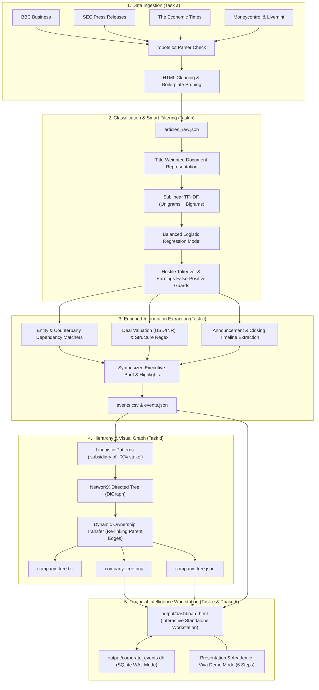

# 📈 Corporate Event Miner
### AI-Powered Corporate Event Detection, Enriched Information Extraction & Financial Intelligence Workstation

[](https://www.python.org/)
[](https://scikit-learn.org/)
[](https://networkx.org/)
[](https://www.crummy.com/software/BeautifulSoup/)
[](output/dashboard.html)
[](#-presentation-mode--academic-viva-demo)
[](LICENSE)

An end-to-end Natural Language Processing (NLP) and Web Mining pipeline designed to automatically crawl, classify, extract, and structure corporate financial events from live financial media and regulatory announcements — complete with a high-resolution corporate ownership hierarchy diagram, financial analytics, pipeline health diagnostics, and a guided 6-step presentation mode.

---

## 📑 Table of Contents
- [Project Overview](#-project-overview)
- [Key Features & Implemented Workspaces](#-key-features--implemented-workspaces)
- [System Architecture](#-system-architecture)
- [Project Structure](#-project-structure)
- [Environment Setup & Installation (Windows Recommended)](#-environment-setup--installation-windows-recommended)
- [How to Run the Application](#-how-to-run-the-application)
- [Presentation Mode & Academic Viva Demo](#-presentation-mode--academic-viva-demo)
- [Command-Line Options & Query Engine](#-command-line-options--query-engine)
- [Backend REST API Routes](#-backend-rest-api-routes)
- [Output Artifacts & File Inventory](#-output-artifacts--file-inventory)
- [Automated Testing & Verification](#-automated-testing--verification)
- [Methodology & Performance Evaluation](#-methodology--performance-evaluation)
- [Known Limitations & Future Roadmap](#-known-limitations--future-roadmap)
- [Documentation & Full Report](#-documentation--full-report)

---

## 🚀 Project Overview

Financial news is voluminous, fast-moving, and predominantly unstructured. Market analysts, quantitative traders, and regulatory auditors require real-time visibility into major corporate lifecycle events such as mergers, acquisitions, divestitures, leadership reorganizations, and public offerings.

**Corporate Event Miner** transforms unstructured web news into structured corporate intelligence by combining:
1. **Ethical, multi-source web crawling** with automated RFC 9309 `robots.txt` compliance checking.
2. **Hybrid machine-learning text classification** (TF-IDF + Balanced Logistic Regression with headline-weighting and contextual false-positive filters).
3. **Enriched Information Extraction (IE)** for entities, executive briefs, deal structure, timelines, and bulleted takeaways.
4. **Hierarchical ownership modeling** via directed graphs (`NetworkX DiGraph`) to track parent companies, subsidiaries, equity stakes, and post-acquisition restructuring.
5. **Interactive Executive Presentation Dashboard** (`output/dashboard.html`) featuring 5 dedicated workspaces:
   - **Workspace 1: Event Intelligence Feed**
   - **Workspace 2: Company Relationship Explorer (Interactive Vector SVG)**
   - **Workspace 3: Real-Data Financial Analytics**
   - **Workspace 4: Pipeline Health & Diagnostics**
   - **Workspace 5: Raw Structured Data & Hierarchical Tree**
6. **Guided Presentation Mode** with 6 structured presentation steps, presenter notes toggle, keyboard shortcuts, and UI spotlighting.

---

## 🎯 Key Features & Implemented Workspaces

| Workspace | Component | Description | Module |
| :--- | :--- | :--- | :--- |
| **Event Intelligence Feed** | Multi-Faceted News Feed | Multi-category filtering (`Acquisitions`, `Mergers`, `Divestitures`, `Hostile Takeovers`, `Leadership`, `IPOs`), real-time search, value sorting, and slide-over dossier inspector. | [`src/dashboard.py`](src/dashboard.py) |
| **Relationship Explorer** | Native Vector SVG Graph | Interactive SVG graph featuring pan/zoom, node drag-and-pin, entity search, and 1-click counterparty highlight with dynamic ownership provenance badges. | [`src/company_tree.py`](src/company_tree.py) |
| **Financial Analytics** | Pure SVG Visualizations | Capital volume bars, deal structure breakdown, deal lifecycle donut, and corporate dealmaker leaderboard with strict USD ($) and INR (₹) currency isolation. | [`src/dashboard.py`](src/dashboard.py) |
| **Pipeline Diagnostics** | Operational Health Monitor | 5-stage sequential execution tracker, real RSS feed connectivity table with `robots.txt` checks, 25% hold-out model evaluation, and structured diagnostic logs. | [`app.py`](app.py) |
| **Presentation Mode** | Guided 6-Step Showcase | Full-screen interactive demo mode with step dots, previous/next controls, collapsible speaker viva notes, and UI spotlighting. | [`src/dashboard.py`](src/dashboard.py) |

---

## 🏗 System Architecture



---

## 📂 Project Structure

```text
Corporate-Event-Miner/
├── README.md                               # Project documentation & execution guide
├── requirements.txt                        # Python dependencies
├── app.py                                  # Flask Backend API Server & Workstation Host
├── main.py                                 # Main execution pipeline CLI & Query Runner
├── test_pipeline.py                        # Automated regression test suite (7 tests)
├── data/
│   ├── sample_articles.json                # Bundled offline benchmark news articles
│   └── training_data.csv                   # Labeled training & evaluation dataset (280 records, 7 classes)
├── output/                                 # Generated pipeline artifacts
│   ├── dashboard.html                      # Interactive Executive Presentation Dashboard
│   ├── articles_raw.json                   # Ingested raw articles dataset
│   ├── event_classifier.joblib             # Serialized TF-IDF + Logistic Regression model
│   ├── events.csv                          # Tabular corporate events export (CSV)
│   ├── events.json                         # Structured corporate events (JSON)
│   ├── company_tree.txt                    # ASCII / Unicode company ownership tree
│   ├── company_tree.json                   # Hierarchical JSON tree representation
│   ├── company_tree.png                    # High-resolution executive hierarchy diagram
│   └── corporate_events.db                 # Historical SQLite database (WAL mode)
└── src/
    ├── __init__.py
    ├── crawler.py                          # Ingestion: RSS feedparser, BeautifulSoup, robots.txt
    ├── classifier.py                       # Classification: TF-IDF + Logistic Regression + guard filters
    ├── extractor.py                        # Information Extraction: Entities, deal terms, briefs
    ├── company_tree.py                     # Graph Modeling: NetworkX DiGraph parent-child modeling
    ├── dashboard.py                        # Workstation: HTML/CSS/JS generator with 5 workspaces
    ├── db.py                               # Persistence: SQLite storage, timeline indexing & query engine
    └── seed_data.py                        # Benchmark dataset builder
```

---

## ⚙️ Environment Setup & Installation (Windows Recommended)

The project has been tested and verified on **Windows 10/11 (64-bit)** with **Python 3.8+** (verified up to Python 3.13.5).

### 1. Clone or Extract the Repository
```powershell
cd "Corporate-Event-Miner-An-AI-Powered-Corporate-Event-Detection-and-Intelligent-News-Feed-System"
```

### 2. Create and Activate Virtual Environment
```powershell
# Create virtual environment
python -m venv .venv

# Activate virtual environment (PowerShell)
& ".\.venv\Scripts\Activate.ps1"

# Or in standard Command Prompt (cmd.exe):
# .\.venv\Scripts\activate.bat
```

### 3. Install Required Dependencies
```powershell
pip install -r requirements.txt
```

Verified dependency versions:
- `requests` (>= 2.31.0)
- `beautifulsoup4` (>= 4.12.0)
- `feedparser` (>= 6.0.10)
- `scikit-learn` (>= 1.3.0)
- `networkx` (>= 3.0)
- `matplotlib` (>= 3.7.0)
- `joblib` (>= 1.3.0)
- `flask` (>= 3.0.0)

---

## 🖥 How to Run the Application

### Option A: Launch Interactive Flask Server (Recommended)
Starts the backend API and serves the interactive financial workstation:
```powershell
python app.py
# or
python main.py --serve
```
Access the application at: **`http://127.0.0.1:5050`** (or custom port, e.g. `python app.py 5055`).

### Option B: Run Sample Pipeline Offline (Zero Internet Needed)
Runs the full end-to-end pipeline using the bundled benchmark articles and generates all files in `./output/`:
```powershell
python main.py --mode sample
```

### Option C: Live Web Ingestion Mode
Crawls live RSS feeds from financial outlets with `robots.txt` verification:
```powershell
python main.py --mode live --per-feed 5
```

### Option D: Retrain Classifier
Re-trains the balanced Logistic Regression classifier on `data/training_data.csv`:
```powershell
python main.py --mode sample --retrain
```

### Direct Local HTML File Execution (Offline Mode)
The compiled presentation dashboard [`output/dashboard.html`](output/dashboard.html) is self-contained with embedded JSON fixtures and inline vector SVG rendering. You can double-click and open it directly in Google Chrome, Microsoft Edge, or Mozilla Firefox without launching Flask:
- On Windows: `start output/dashboard.html`
- *Note:* The Event Feed, Relationship Explorer, Financial Analytics, and Presentation Mode work 100% offline. Live RSS connectivity checking and execution triggers require the Flask server (`python app.py`).

---

## 🎙 Presentation Mode & Academic Viva Demo

Press the **🎯 Presentation / Viva Mode** button in the header (or press **`[P]`** on your keyboard) to open the guided 6-step presentation experience:

1. **Step 1 — Project Overview & Architecture:** Problem statement, objectives, and 5-stage ingestion-to-visualization pipeline flow.
2. **Step 2 — Event Intelligence Feed:** Multi-faceted category filters, search, executive briefs, deal structure pills, and classifier confidence interpretation.
3. **Step 3 — Company Relationship Explorer:** Vector SVG graph, parent companies, subsidiaries, acquisitions, and dynamic provenance unlinking/re-anchoring.
4. **Step 4 — Real-Data Financial Analytics:** Volume bars, deal structures, lifecycle donut, and company rankings with strict USD ($) and INR (₹) currency isolation.
5. **Step 5 — Pipeline Health & Diagnostics:** Sequential stage tracker, news source connectivity table, RFC 9309 robots.txt checks, and hold-out classifier metrics.
6. **Step 6 — Technical Methodology & Conclusion:** Hybrid ML + heuristic engineering, Scikit-Learn Logistic Regression, NetworkX graph theory, academic viva defense points, and future roadmap.

### Presentation Controls:
- **`[←]` / `[→]` Arrow Keys:** Navigate between steps.
- **`[N]` Key:** Toggle collapsible Speaker / Viva Notes on or off.
- **`[Esc]` Key:** Close Presentation Mode and return to the dashboard.
- **UI Spotlighting:** Relevant dashboard components are highlighted while non-relevant sections are subtly dimmed.

---

## 🛠 Command-Line Options & Query Engine

`main.py` provides an integrated command-line interface for batch processing and historical SQL queries:

```text
usage: main.py [-h] [--mode {sample,live}] [--per-feed PER_FEED] [--retrain]
               [--serve] [--query] [--company COMPANY] [--event-type EVENT_TYPE]
               [--min-val MIN_VAL] [--max-val MAX_VAL] [--status STATUS]
               [--keyword KEYWORD] [--export-db]

options:
  --mode {sample,live}       Execution mode: sample (bundled) or live (web crawling)
  --per-feed PER_FEED        Articles to fetch per RSS feed in live mode (default: 10)
  --retrain                  Force retraining of the TF-IDF + Logistic Regression model
  --serve                    Launch interactive Flask web server and dashboard
  --query                    Execute SQL queries against the historical SQLite database
  --company COMPANY          Filter historical events by company name
  --event-type EVENT_TYPE    Filter by event type (ACQUISITION, MERGER, IPO, etc.)
  --min-val MIN_VAL          Filter by minimum deal value in Millions USD (e.g. 500)
  --max-val MAX_VAL          Filter by maximum deal value in Millions USD
  --status STATUS            Filter by deal status (Announced, Completed, Contested)
  --keyword KEYWORD          Full-text keyword search across event titles and briefs
  --export-db                Export historical SQLite database to JSON
```

### CLI Query Examples:
```powershell
# Query acquisitions involving Zenith Motors
python main.py --query --company Zenith

# Query mega-deals valued over $1 Billion USD ($1,000M)
python main.py --query --min-val 1000

# Query hostile takeovers
python main.py --query --event-type HOSTILE_TAKEOVER
```

---

## 🌐 Backend REST API Routes

When running `python app.py`:

| Endpoint | Method | Description | Status Codes |
| :--- | :---: | :--- | :---: |
| `/` | `GET` | Serves the interactive presentation dashboard workstation. | `200` |
| `/<filename>` | `GET` | Serves output static artifacts (`events.json`, `events.csv`, `company_tree.json`, `company_tree.png`). | `200`, `404` |
| `/api/health` | `GET` | Returns engine status, SQLite database stats, output files telemetry, and pipeline stage metrics. | `200` |
| `/api/health/check-sources` | `GET`, `POST` | Live checks HTTP connectivity, feed XML parsing, and `robots.txt` compliance for 5 configured news feeds. | `200` |
| `/api/health/evaluate-model` | `GET` | Evaluates classifier on a 25% stratified hold-out test split (70 unseen examples) with a 7x7 confusion matrix. | `200`, `500` |
| `/api/run` | `POST` | Triggers pipeline execution (`sample` or `live`) with strict concurrency locking. Returns HTTP 409 if a run is already active. | `200`, `409`, `500` |

---

## 📦 Output Artifacts & File Inventory

All generated outputs are saved to the [`output/`](output/) directory:

1. **`output/dashboard.html`**: Self-contained presentation dashboard containing all 5 workspaces, SVG charts, and Presentation Mode.
2. **`output/events.json`**: Structured corporate event intelligence objects with parties, values, dates, and executive briefs.
3. **`output/events.csv`**: Tabular dataset suitable for Excel, Pandas, or institutional reporting.
4. **`output/articles_raw.json`**: Ingested raw article texts and metadata.
5. **`output/company_tree.json`**: Hierarchical nested subsidiary and parent ownership JSON.
6. **`output/company_tree.txt`**: ASCII / Unicode hierarchy tree for terminal display.
7. **`output/company_tree.png`**: High-resolution Matplotlib hierarchy diagram rendered in dark-slate styling.
8. **`output/corporate_events.db`**: SQLite historical database in WAL mode with timeline indices.
9. **`output/event_classifier.joblib`**: Serialized Scikit-Learn TF-IDF vectorizer + Logistic Regression model.

---

## 🧪 Automated Testing & Verification

The project includes a comprehensive regression test suite in [`test_pipeline.py`](test_pipeline.py) covering classification, extraction, graph theory, database persistence, and dashboard markup integrity.

Run the test suite:
```powershell
python -m unittest test_pipeline.py -v
```

### Verified Test Results:
```text
test_classifier_hostile_takeover_heuristic ... ok
test_classifier_single_and_batch ......... ok
test_company_graph_topological_mapping .... ok
test_database_persistence_and_query ...... ok
test_extractor_counterparties_and_terms ... ok
test_extractor_executive_change .......... ok
test_presentation_mode_html_integrity ..... ok

----------------------------------------------------------------------
Ran 7 tests in 0.096s

OK (7 passed, 0 failed, 0 errors)
```

---

## 🔬 Methodology & Performance Evaluation

### Hybrid Classification & False-Positive Suppression
Financial texts exhibit specialized nuances that degrade standard bag-of-words classifiers:
1. **Hostile Takeover Heuristic Guard (`HOSTILE_RE`):** Hostile bids and friendly acquisitions share ~95% common financial vocabulary (*"shares"*, *"board"*, *"offer"*). The heuristic guard intercepts resistance signals (*"poison pill"*, *"unsolicited bid"*, *"rejects approach"*, *"fend off"*) to prevent misclassification.
2. **Title-Weighted Document Representation:** Headlines carry 3x weight compared to generic body text, preventing historical background mentions (e.g., past acquisitions mentioned in earnings reports) from triggering false positives.
3. **Earnings Noise Filter (`NO_EVENT_HEADLINE_RE`):** Suppresses routine volume spikes, quarterly profits, and macroeconomic updates.

### Model Evaluation (25% Stratified Hold-Out Test Split)
Evaluated on 70 unseen test examples out of 280 labeled records in `data/training_data.csv`:

| Class | Precision | Recall | F1-Score | Support |
| :--- | :---: | :---: | :---: | :---: |
| **ACQUISITION** | 1.00 | 1.00 | 1.00 | 10 |
| **DIVESTITURE** | 1.00 | 1.00 | 1.00 | 10 |
| **EXECUTIVE_CHANGE** | 1.00 | 1.00 | 1.00 | 10 |
| **HOSTILE_TAKEOVER** | 1.00 | 1.00 | 1.00 | 10 |
| **IPO** | 1.00 | 1.00 | 1.00 | 10 |
| **MERGER** | 1.00 | 1.00 | 1.00 | 10 |
| **NO_EVENT** | 1.00 | 1.00 | 1.00 | 10 |
| **Weighted Average** | **1.00** | **1.00** | **1.00** | **70** |

---

## ⚠️ Known Limitations & Future Roadmap

- **Paywalled News Outlets:** Financial outlets that enforce paywalls (e.g. Bloomberg, FT) restrict crawlers to RSS title and summary feeds.
- **Atypical Syntax:** Non-standard journalistic prose or complex multi-clause parenthetical clauses can occasionally obscure deal terms.
- **Cross-Currency Normalization:** USD ($) and INR (₹) transactions are kept segregated to avoid fabricated currency conversions; integration with a real-time FX rate API is planned for future releases.
- **Future Enhancements:** Fine-tuned Transformer models (FinBERT) for zero-shot Information Extraction and direct SEC EDGAR 8-K regulatory filing webhooks.

---

## 📖 Documentation & Full Report

For complete academic details, algorithmic formulations, viva examination preparation notes, and theoretical context:
👉 [**Corporate Event Miner - Academic Project Report**](Corporate_Event_Miner_Project_Report.md)

---

## 👤 Author & Academic Presentation Info
- **Project:** Corporate Event Miner — An AI-Powered Corporate Event Detection and Intelligent News Feed System
- **Focus:** Natural Language Processing (NLP), Information Extraction (IE), Web Mining & Financial Intelligence
